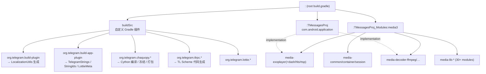
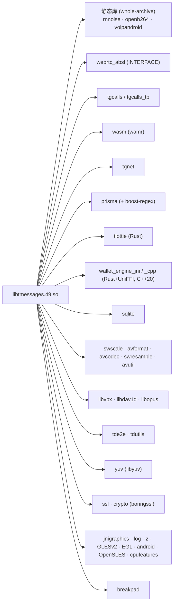
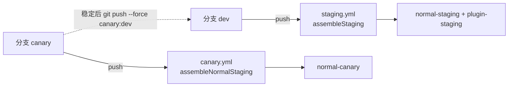

# Nagram XF 架构与模块依赖说明

> 适用版本：Telegram 基线 `13.0.2 (7175)`，fork `verCode 1252`，包名 `fork.risin42.nagramx`
> 本文档描述 **现状代码**，不描述历史来源。

---

## 1. 全局分层视图

```
┌──────────────────────────────────────────────────────────────────────────────┐
│  应用层 (Java/Kotlin, ~3385 files, 7970 res files)                            │
│                                                                                │
│  ┌──────────────┬───────────────┬──────────────┬──────────────┬─────────────┐ │
│  │ org.telegram │ tw.nekomimi   │ com.extera-  │ com.radolyn  │ xyz.next-   │ │
│  │ .ui  (1545)  │ .nekogram(183)│ gram (60)    │ .ayugram(57) │ alone (6)   │ │
│  │ org.telegram │ Nekogram 功能 │ exteraGram   │ AyuGram      │ nextalone   │ │
│  │ .messenger   │               │ 功能          │ 功能          │ 功能        │ │
│  │ (369)        │               │              │              │             │ │
│  └──────┬───────┴───────┬───────┴──────┬───────┴──────┬───────┴─────────────┘ │
│         │               │              │              │                       │
│  ┌──────▼───────────────▼──────────────▼──────────────▼────────────────────┐  │
│  │ Telegram 内核骨架（所有功能模块共同依赖）                                 │  │
│  │  • NotificationCenter 事件总线   • AccountInstance 多账号模型            │  │
│  │  • DispatchQueue 线程池          • MessagesController/MessagesStorage   │  │
│  │  • BaseFragment/ListView/Cells/ActionBar（自研 UI 框架，非 Compose）     │  │
│  │  • LocaleController 本地化       • SharedConfig/UserConfig（偏好）       │  │
│  └──────┬───────────────────────────────────────────────────────────────────┘  │
│         │                                                                      │
│  ┌──────▼──────────────┐   ┌────────────────────┐   ┌───────────────────────┐ │
│  │ org.telegram.tgnet  │   │ org.telegram.SQLite│   │ com.google.android    │ │
│  │ MTProto 网络封装(42) │   │ SQLite 封装        │   │ .exoplayer2 (fork,847)│ │
│  └──────┬──────────────┘   └──────┬─────────────┘   └──────────┬────────────┘ │
└─────────┼─────────────────────────┼────────────────────────────┼──────────────┘
          │ JNI                     │ JNI                        │ JNI
┌─────────▼─────────────────────────▼────────────────────────────▼──────────────┐
│  Native 层  libtmessages.49.so  (C/C++17, CMake)                               │
│  ┌─────────┬─────────┬────────┬────────┬────────┬─────────┬────────┬───────┐ │
│  │ tgnet   │ sqlite  │ image  │ ffmpeg │ voip   │ tgcalls │ tde2e  │prisma │ │
│  │(MTProto)│         │(jpeg/  │ _jni   │(webrtc)│(群通话) │(E2E)   │(正则) │ │
│  │         │         │ webp)  │        │        │         │        │       │ │
│  ├─────────┼─────────┼────────┼────────┼────────┼─────────┼────────┼───────┤ │
│  │ breakpad│  lottie │ intro  │ fast-  │ genann │ secureid│ wallet │tde2e  │ │
│  │(崩溃)   │(动画)   │(启动页)│ edge   │(OCR-NN)│ _ocr    │-engine │bridge │ │
│  └─────────┴─────────┴────────┴────────┴────────┴─────────┴────────┴───────┘ │
│                                                                                │
│  libaliuhook.so  (仅 plugin flavor, arm/arm64)                                 │
│  ┌──────────────────────────────────────────────────────────────────────────┐ │
│  │ LSPlant (ART 方法 Hook) ←→ shadowhook (inline hook libart)               │ │
│  └──────────────────────────────────────────────────────────────────────────┘ │
└────────────────────────────────────────────────────────────────────────────────┘
          ▲
          │ Chaquopy JNI 桥 (libchaquopy_java.so / chaquopy.so)
┌─────────┴──────────────────────────────────────────────────────────────────────┐
│  Python 插件运行时  CPython 3.11 (Chaquopy 16.1.0)                              │
│  sdk_pysrc/ → assets/plugins_pysdk/sdk-<abi>.zip                                │
│  elyxcore · base_plugin · plugin_settings · android_utils · client_utils · ui   │
└────────────────────────────────────────────────────────────────────────────────┘
```

---

## 2. Gradle 模块图



**模块清单**

| 模块 | 类型 | 职责 |
|---|---|---|
| `:TMessagesProj` | application | 主 APK，全部 Java/Kotlin + native 编译入口（`jni/CMakeLists.txt`） |
| `:TMessagesProj_Modules:media3:*` | library ×30+ | ExoPlayer/Media3 fork，`media_settings.gradle` 动态 include |
| `buildSrc` | included build | 自定义 Gradle 插件 + 代码生成器（Kotlin DSL，AGP 8.13.2 on classpath） |

**关键：为什么 AGP 版本在 buildSrc 定义**
`build.gradle` 注释说明：`org.telegram.build-app-plugin` 需要 AGP 在 classpath 上（Lottie/strings 任务类型引用 AGP 内部类 `LinkApplicationAndroidResourcesTask`），因此 AGP 由 buildSrc 提供，根构建脚本不能再声明版本，否则冲突。

---

## 3. Flavor × BuildType × ABI 矩阵

```
flavorDimension: 'runtime'
   ├── normal ──► ENABLE_PLUGINS=OFF, abiFilters = [armv7, arm64, x86_64], universalApk=true
   └── plugin ──► ENABLE_PLUGINS=ON,  abiFilters = [armv7, arm64],         universalApk=true(pruned)

buildType: debug | staging | release

产物 = flavor × buildType × ABI (+universal)
```

| flavor | ABI 数 | APK 数 | libaliuhook | Python 运行时 | 插件入口 | CMake 开关 |
|---|---|---|---|---|---|---|
| **normal** | 3 + universal | **4** | ✗ | ✗（不打包 `plugins_pysdk/`、`chaquopy/`） | ✗ | `-DENABLE_PLUGINS=OFF` |
| **plugin** | 2（无 universal） | **2** | ✓ | ✓ | ✓ | `-DENABLE_PLUGINS=ON` |

**硬约束**：插件只支持 arm —— shadowhook 无 x86 支持（见 `aliuhook.cpp` 头注释与 `build.gradle` 第 78-79 行）。`androidComponents.onVariants` 中对 plugin flavor 的每个 output 做 `output.enabled.set(pluginAbis.contains(abi))` 收窄。

**`NATIVE_TARGET` 加速模式**：设 `NATIVE_TARGET=arm64-v8a` 时 `splits.abi.include` 收窄为单 ABI 且 `universalApk=false`；此时 **不能再设 `ndk.abiFilters`**（AGP 规则：splits.abi 收窄且无 universal 时 abiFilters 必须为空，否则配置期 `Conflicting configuration`）。
`NATIVE_TARGET=SKIP` 则关闭所有含 cmake/jni/test 的任务。

---

## 4. Source Set 矩阵（stub vs 真实实现）

这是本项目 flavor 隔离的核心技巧：**同一批类在 `plugin` 与 `normal` 下用不同 source set 提供两个版本**。

| source set | 内容 | 生效 flavor |
|---|---|---|
| `src/main` | 共享代码、资源、TL scheme、全部业务功能 | 两者 |
| `src/plugin` | 插件子系统 **真实实现** + `assets/plugins_pysdk/*.zip` + `com.chaquo.python.*` Java 桥 + `assets/chaquopy/` | plugin |
| `src/normal` | 插件子系统的 **空壳/降级实现**（`PluginsController`、`PluginsActivity`、`XposedBridge`、`NativeCrashHandler`、`MenuContextBuilder`… 均为 no-op） | normal |
| `src/full` | `ExteraConfig`、`PluginSettingsActivity` 的覆盖版 | （构建变体组合） |
| `src/debug` | `assets/plugins/smoke_test.plugin` 冒烟测试插件 | debug |
| `src/test` | 单元测试（Ayu DB / 翻译实体） | 测试 |

> 影响：改插件相关代码时，**必须同时考虑 `src/plugin`（真实）和 `src/normal`（桩）两侧**，否则 normal 包编译失败。

**Manifest 合并**：`src/plugin/AndroidManifest.xml` 注入 `AliuHookInitProvider`（ContentProvider，`initOrder=9999`）在 `Application.onCreate` 前加载 `libaliuhook.so`；normal 包不声明、也没有该 so。

---

## 5. 启动时序与插件初始化链

```
Process start
  │
  ├─ ApplicationLoader.attachBaseContext()          [NativeLoader 加载 libtmessages.49.so]
  │     └─ (plugin) MultiDex / chaquopy 准备
  │
  ├─ ContentProvider.onCreate(): AliuHookInitProvider  ← plugin flavor only
  │     └─ XposedBridge.isNativeAvailable() ? XposedBridge.ensureInitialized()
  │           └─ System.loadLibrary("aliuhook")
  │                 ├─ JNI_OnLoad: 仅保存 JavaVM，**故意不初始化**
  │                 └─ ensureInitialized() → initRuntime()  [Java caller context 下]
  │                       ├─ mmap W+X 探针 (SELinux execmem)
  │                       ├─ shadowhook_init(SHADOWHOOK_MODE_UNIQUE)
  │                       ├─ shadowhook_dlopen("libart.so")
  │                       ├─ DisableHiddenApiRestrictionsInternal()
  │                       │     └─ VMRuntime_setHiddenApiExemptions(env, clazz, ["L"])
  │                       ├─ lsplant::Init(env, {inline_hooker, unhooker, art_symbol_resolver…})
  │                       └─ InitInvokeConstructorCache(8 个包装类 + Executable.getParameterTypes)
  │
  └─ ApplicationLoader.onCreate()
        └─ ExteraConfig.init()
              ├─ BadgesController.init()
              └─ PluginsController.init(lambda → executeOnAppEvent(APP_START))
                    ├─ 读 safe mode 标志 (PREF_PENDING_CRASH / crashed_plugin_id)
                    ├─ PythonPluginsEngine.initSdk()  → 解压 sdk-<abi>.zip，导入 elyxcore
                    └─ 逐个插件实例化 + 注册 hook
```

**为什么 `JNI_OnLoad` 不初始化 LSPlant**：`JNI_OnLoad` 运行在 "unknown caller context"，LSPlant 的 `InitJNI` 会解析 `Class.accessFlags` 等 hidden API 而被拒；延迟到被 `"L"` 豁免覆盖的 Java caller（`XposedBridge`）里执行才能成功。（`aliuhook.cpp` L738-751）

---

## 6. Native 依赖图（libtmessages.49.so 链接关系）



**链接/符号策略**（`jni/CMakeLists.txt`）

| 设置 | 值 | 目的 |
|---|---|---|
| 全局 C/C++ | `-ffunction-sections -fdata-sections -fvisibility=hidden -flto=full` | 死代码消除 + LTO |
| 主库编译 | `-ffast-math -Oz -funroll-loops -fno-strict-aliasing -fno-math-errno` | 体积/性能 |
| 主库链接 | `-flto=full -Wl,--gc-sections -Wl,--icf=safe -Wl,-Bsymbolic` + `--exclude-libs,<静态库列表>` | 隐藏三方符号 |
| 版本脚本 | `exports.map`：只导出 `Java_*`/`JNI_OnLoad`/`JNI_OnUnload` | 对外符号面最小化 |
| 页大小 | `-Wl,-z,max-page-size=16384` + `-z,common-page-size=16384` + `-DANDROID_SUPPORT_FLEXIBLE_PAGE_SIZES=ON` | 16KB page 适配 |
| 预编译产物 | `jni/prebuild/lib/<abi>/*.a`、`prebuild/include/` | 已构建的三方静态库 |

**子模块（`.gitmodules`，共 23 个）**：
`tlottie`, `libvpx`, `dav1d`, `ffmpeg`, `xiph/{ogg,opusfile,opus}`, `libyuv`, `lsplant`(fork), `shadowhook`(fork), `openh264`, `boringssl`, `td`, `absl`, `wamr`, `tgcalls`(fork), `wallet-engine`(Rust), `boost-regex`, `libprisma`, `TMessagesProj_Modules/media`, `lib/jlatexmath`
> 注意 `lsplant` / `shadowhook` / `tgcalls` 指向 **fork 仓库**（`Keeperorowner/*`），不是上游。

**`aliuhook` 独立目标**：`add_library(aliuhook SHARED)`，C++20，仅 arm/arm64，链接 `lsplant_static + shadowhook + log + z + dl`。**不**链接 tmessages 静态库（linker flags 特意不放进全局 `CMAKE_SHARED_LINKER_FLAGS`，避免 aliuhook 被迫依赖 tmessages 归档）。

---

## 7. 插件子系统数据流

```
┌─────────────────────── 安装期 ───────────────────────┐
│ .plugin 文件 (内嵌 base64 DEX 的归档)                 │
│   → InstallPluginBottomSheet / PluginsController      │
│   → 安全审查 (JADX 提取 DEX, 按包名归属)              │
│   → 解压至插件目录, 记录元数据                        │
└───────────────────────┬──────────────────────────────┘
                        │
┌───────────────────────▼─────────── 运行期 ───────────────────────────┐
│  Python 插件代码                                                     │
│    from elyx import ...            ← elyx = elyxcore 运行时别名       │
│    plugin = BasePlugin() / ElyxPlugin                                │
│                                                                      │
│  ┌───────────────────────────────────────────────────────────────┐  │
│  │ Python SDK (sdk_pysrc)                                         │  │
│  │  elyxcore: _engine · _plugin_engine · _importer · _install     │  │
│  │            _plugin · settings · localization · assets · utils  │  │
│  │  extera_utils: get_caller · metadata_parser · text_formatting  │  │
│  │  ui: alert · bulletin · settings                              │  │
│  │  android_utils · client_utils · hook_utils · intents ·        │  │
│  │  file_utils · markdown_utils · dev_server                    │  │
│  └────────────────────────┬──────────────────────────────────────┘  │
│                           │ Chaquopy (JNI)                          │
│  ┌────────────────────────▼──────────────────────────────────────┐  │
│  │ Java 宿主 (src/plugin/java)                                    │  │
│  │  PythonPluginsEngine ── 解压 sdk zip / 导入 elyxcore / 管实例   │  │
│  │  PluginsController ───→ PluginsHooks (HookRecord,             │  │
│  │                         EventHookRecord, MenuItemRecord,       │  │
│  │                         XposedHookRecord)                     │  │
│  │  PyMethodHook / PyMethodReplacement ── Xposed 风格回调        │  │
│  │  ClassProxy (dexmaker) · MethodCache · PyObjectUtils          │  │
│  └────────────────────────┬──────────────────────────────────────┘  │
│                           │ XposedBridge.hook0() (JNI)              │
│  ┌────────────────────────▼──────────────────────────────────────┐  │
│  │ libaliuhook.so                                                 │  │
│  │  Java_de_robv_android_xposed_XposedBridge_hook0                │  │
│  │    → lsplant::Hook(env, member, callback, method)             │  │
│  │        → shadowhook_hook_func_addr(libart 符号)               │  │
│  │  unhook0 · deoptimize0 · invokeConstructor0 ·                 │  │
│  │  allocateInstance0 · makeClassInheritable0 ·                  │  │
│  │  disableHiddenApiRestrictions · disableProfileSaver ·         │  │
│  │  initRuntime · getInitDiag                                    │  │
│  └───────────────────────────────────────────────────────────────┘  │
└──────────────────────────────────────────────────────────────────────┘

稳定性旁路:
  NativeCrashHandler（信号处理 → flag 文件）
    → 下次启动 PluginsController 读 flag → SafeModeBottomSheet / PluginsWatchdog
```

**Chaquopy 源码构建流水线**（`buildSrc/.../chaquopy/ChaquopyTasks.kt` + `TMessagesProj/build.gradle`）

```
jni/chaquopy/*.pyx ──Cython 3.0.11──► chaquopy.c / chaquopy_java.c
      │                                      │
      │  + 后处理(JNIEXPORT 标注, 禁 __pyx_insert_code_object)
      ▼                                      ▼
   NDK clang (C++/C, -O2 -DNDEBUG, minSdk 级别)
      ├─► chaquopy.so          (asset: chaquopy/bootstrap-native/<abi>/java/)
      └─► libchaquopy_java.so  (lib/<abi>/)
                    │
   上游 maven 制品 ──┼─► stdlib-common.imy / stdlib-<abi>.imy / libpython3.11.so / lib-dynload
   repo python 源码 ─┴─► bootstrap.imy / cacert.pem / requirements-*.imy
                    │
   build.json (各资产哈希, 门禁解压) ◄── generateChaquopyBuildJson
```

**不能破坏的三点**（AGENTS.md 制度化）：`CYTHON_PEP489_MULTI_PHASE_INIT 0`；libpython 必须 `-L <dir> -lpython3.11` 链接；JNI 导出必须经后处理带 `JNIEXPORT`（27 个）。

---

## 8. 代码生成（buildSrc 任务）

| 生成器 | 输入 | 输出 | 用途 |
|---|---|---|---|
| `org.telegram.tlrpc.*`（SchemeCodeGen/JsonParser/TlValidator） | `TMessagesProj/schemas/*.json` + `.tl` | `TLRPC.java` / `TLObject` 等 | TL layer 代码生成 |
| `TelegramStringsTask` | `src/*/res/values*/strings*.xml`（5 套前缀） | `res/` + `assets/` + stable-ids | 本地化 + 字符串 ID 稳定 |
| `GenerateStringResourceIdsAssetTask` | RUNTIME_SYMBOL_LIST | assets | 运行时字符串 ID 映射 |
| `GenerateLottieMetadataAssetFileTask` | `res/raw*/*.json` | assets | Lottie 元数据 |
| `GenerateLocalizationUtilsJavaTask` | `values-*/strings*.xml` | Java | LocaleController 工具类 |
| `Chaquopy*`（7 个任务） | pyx / maven 制品 / bootstrap | so + imy + build.json | 插件运行时打包 |

**本地化五套前缀**：`strings.xml`(官方) · `strings_na.xml` · `strings_nax.xml`(NagramX) · `strings_naxf.xml`(NagramXF) · `strings_neko.xml`(Nekogram)。
**locale 目录**：`values/`, `values-ja-rJP/`, `values-ko/`, `values-night/`, `values-night-v31/`, 以及 AGENTS.md 点名的 zh-rCN / zh-rTW / ru-rRU / uk 等。
Lint 已 `disable 'MissingTranslation', 'ExtraTranslation', 'BlockedPrivateApi'` —— **翻译完整性靠流程保证，不靠 lint**。

---

## 9. 数据与存储

| 存储 | 位置 | 说明 |
|---|---|---|
| Telegram 主库 | `org.telegram.SQLite` + native sqlite | 消息/会话缓存 |
| AyuGram 库 | `com.radolyn.ayugram.database.AyuDatabase` (Room 2.8.4) | 已删除/已编辑消息、幽灵模式、正则过滤；schema 导出至 `TMessagesProj/schemas/`（v21…v35） |
| 偏好 | `SharedPreferences`：`exteraconfig`、Telegram 自身 pref | `ExteraConfig` 静态缓存 + `reloadConfig()` |
| 文件缓存 | `FileLoader` / `ImageLoader` / `FilePathDatabase` | 媒体与缓存管理 |
| 插件 | 插件目录 + SDK 解压目录 | `.plugin` 运行时安装，非 APK 一部分 |

---

## 10. 构建 / CI / 发布流



- **CI 环境**（两 workflow 一致）：ubuntu-latest · JDK 21 · Android SDK `build-tools;36.0.0 ndk;27.2.12479018 platforms;android-36` · Python 3.11.9 · `pip install Cython==3.0.11` · ccache 10G · Gradle 缓存。
- **密钥注入**：`LOCAL_PROPERTIES`（base64 编码的 local.properties）+ `BUILD_TIMESTAMP` + `COMMIT_ID`（写入 versionName 后缀）。
- **发版**：仓库惯例是单个 `Version Bump` 提交，只改 `TMessagesProj/build.gradle` 的 `verCode`。
- **dev 是 canary 的稳定镜像**：不要往 dev 单独 cherry-pick。

---

## 11. 目录速查

```
NagramXF/
├── TMessagesProj/                    ← 主模块
│   ├── src/main/java/                ← 官方 + 各 fork 功能
│   ├── src/main/kotlin/              ← Nekogram/nextalone Kotlin
│   ├── src/main/res/                 ← 7970 个资源
│   ├── src/main/assets/              ← emoji.pack / fonts / shaders / 模型 / grammars.dat
│   ├── src/{plugin,normal,full,debug,test}/
│   ├── jni/                          ← CMakeLists.txt + 全部 native 源
│   │   ├── tgnet/ td/ voip/ tgcalls/ tde2e/ emoji/
│   │   ├── aliuhook/aliuhook.cpp     ← 插件 hook 运行时
│   │   ├── chaquopy/                 ← Cython 桥源码 + bootstrap
│   │   ├── third_party/              ← 18 个第三方 submodule
│   │   ├── prebuild/lib/<abi>/       ← 预编译静态库
│   │   └── exports.map
│   ├── emoji/                        ← EPK3 打包/优化工具链 (Python)
│   └── schemas/                      ← Room schema 导出
├── TMessagesProj_Modules/media/      ← Media3 fork（submodule）
├── buildSrc/src/main/kotlin/         ← Gradle 插件 + 代码生成
├── sdk_pysrc/                        ← Python 插件 SDK 源码（打包成 assets zip）
├── Tools/                            ← SDK 打包 / 上传 / 审计脚本
├── .github/workflows/                ← staging.yml / canary.yml
├── gradle/wrapper/                   ← Gradle 9.4.0
└── AGENTS.md                         ← 构建/环境/规范活文档（改前须问）
```
